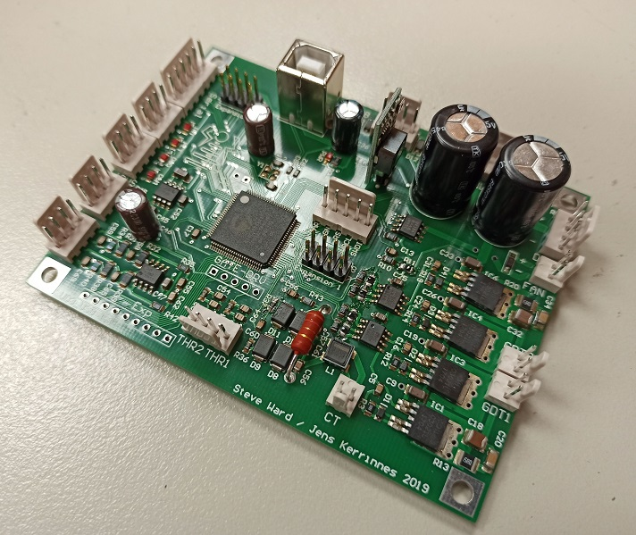

# UD3 Tesla Coil Controller

<div align="center">



**Advanced DRSSTC and QCW Controller with Embedded Interrupter**

[](https://opensource.org/licenses/MIT)
[](https://www.cypress.com/)
[](https://www.freertos.org/)

[Wiki](https://github.com/Netzpfuscher/UD3/wiki) • [Architecture](ARCHITECTURE.md) • [Features](#features) • [Getting Started](#getting-started) • [Simulator](#simulator)

</div>

---

## Overview

UD3 is a comprehensive controller for **DRSSTC** (Dual Resonant Solid State Tesla Coil) and **QCW** (Quasi-Continuous Wave) systems, running on Cypress PSoC microcontrollers with FreeRTOS. It features an embedded interrupter with MIDI/SID audio modulation, safety interlocks, telemetry, and a full-featured command-line interface.

## Features

### 🎵 Audio Modulation
- **Embedded Interrupter** with multiple modes:
  - Classic Mode
  - MIDI playback (polyphonic)
  - SID (Commodore 64 audio)
  - QCW Ramp / MIDI / SID modes
- **Up to six-voice polyphonic synthesis** for complex audio

### 📊 Measurement & Control
- **Primary resonator frequency measurement** via frequency sweep
- **Primary peak current measurement** over feedback CT
- **Bus current measurement** (current or voltage mode CT)
- **Dual voltage measurement** (differential)
- **Pulse skipping** for duty cycle control
- **Grid/fuse power limiter** with configurable fuse rating, I²t trip, and QCW limiting
- **Autotune** frequency sweep for finding the primary resonance

### 🛡️ Safety & Monitoring
- **Alarm/Event system** for fault tracing
- **System fault interlocks**:
  - Undervoltage protection
  - Temperature monitoring
  - Watchdog protection
- **Real-time telemetry** over serial and ethernet

### 🔌 Hardware Interface
- Controls **up to 4 relays** for inrush current management
- External **light display control** for parameter visualization
- **Bootloader** with serial/USB support for firmware updates

### 💻 Software & Communication
- **FreeRTOS-based** for easy extensibility
- **Multi-user command-line** over MIN protocol
- **Serial interface** with VT100 terminal support
- Compatible with **Teslaterm** control software

## Getting Started

### Documentation

See the **[Wiki](https://github.com/Netzpfuscher/UD3/wiki)** for hardware setup, installation and troubleshooting, and **[ARCHITECTURE.md](ARCHITECTURE.md)** for the software architecture and data flow.

Additional references:
- [INFO.md](INFO.md) — CLI commands and parameter reference
- [ARCHITECTURE.md](ARCHITECTURE.md) — firmware, simulator, task and module architecture

### Hardware Requirements

- **Microcontroller**: Cypress PSoC (ARM Cortex-M3)
  - QFN package variant
  - TQFP package variant
- **Development**: Cypress PSoC Creator IDE
- **Control**: Serial/USB connection (460800 baud default)

### Software Tools

- **[Teslaterm](https://github.com/Netzpfuscher/Teslaterm)** - GUI control application
- **Minicom/Screen/PuTTY** - Direct serial terminal access

## Simulator

UD3 includes a **POSIX simulator** for development and testing without hardware.

### Building the Simulator

```bash
cd simulator
make clean
make
./build/ud3sim
```

### Simulator Features

- Full FreeRTOS task scheduling (POSIX threads)
- UART simulation via pseudo-terminal + UDP
- MIN endpoint: UDP port **1337**; pseudo-terminal symlink: **`/tmp/ud3sim-uart`**
- Simulated bus voltage/current, primary current, and autotune resonance
- MIN-over-UDP integration tests and an interactive CLI shell
- Test CLI, parameters, VMS, and logic without physical hardware

### Simulator Tests

```bash
# Run the full MIN-over-UDP integration suite against a private simulator:
python3 simulator/tests/test_min_udp.py --start-sim

# Open an interactive UD3 CLI over MIN:
python3 simulator/tests/test_min_udp.py --start-sim --shell
```

The test tool implements the MIN framing and transport layer itself (CRC32, byte stuffing, ACKs, sequence numbers), so it also serves as a reference host implementation.

## Repository Structure

```
UD3/
├── common/                  # Shared code (firmware + simulator)
│   ├── ud3core/            # Core UD3 functionality
│   │   ├── tasks/          # FreeRTOS tasks
│   │   ├── helper/         # Helper modules
│   │   └── ...
│   ├── tterm/              # Terminal library
│   ├── min/                # MIN protocol
│   ├── vms/                # Voice Music System
│   └── rtos/               # FreeRTOS kernel
├── simulator/              # POSIX simulator
│   ├── tests/              # MIN-over-UDP integration tests
│   └── ...
├── ARCHITECTURE.md         # Software architecture and data flow
├── INFO.md                 # CLI and parameter reference
├── docs/                   # Generated Doxygen docs
├── UD3_QFN.cydsn/         # PSoC project (QFN)
├── UD3_TQFP.cydsn/        # PSoC project (TQFP)
└── UARTldr_*.cydsn/       # Bootloader projects
```

## Development

### Code Style

- **Language**: C11
- **Formatting**: clang-format (see `.clang-format`)
- **Indentation**: Tabs (4 spaces wide)
- **Brace style**: K&R (attach)

### Testing

Run the simulator tests before submitting changes:

```bash
cd simulator && make
cd .. && python3 simulator/tests/test_min_udp.py --start-sim
```

### Building Firmware

1. Open `UD3_QFN.cydsn/UD3_QFN.cyprj` or `UD3_TQFP.cydsn/UD3_TQFP.cyprj` in PSoC Creator
2. Build the project
3. Flash to hardware using bootloader or PSoC Creator

## License

MIT License - see file headers for details

**Copyright**: Jens Kerrinnes, Steve Ward, Thorben Zethoff, Malte Schürks

## Contributing

Contributions are welcome! Please:
1. Test changes in the simulator first
2. Match existing code style (tabs, K&R braces)
3. Ensure safety-critical code includes proper error handling
4. Update documentation as needed

## Community

For questions, support, and discussion, visit the [Wiki](https://github.com/Netzpfuscher/UD3/wiki) or open an issue on GitHub.

---

<div align="center">

**⚡ Built for Tesla Coil enthusiasts by Tesla Coil enthusiasts ⚡**

</div>
